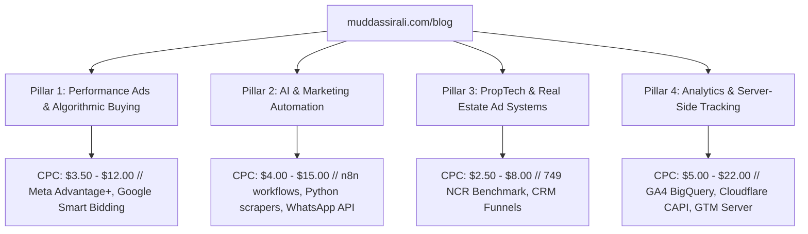

# Muddassir Ali — Blog SEO & Google AdSense Monetization Master Plan (`muddassirali.com`)

## 1. Executive Strategy & Dual-Engine Model

On **Veloxis Global**, you established organic rankings for high-intent B2B agency keywords (e.g., *real estate marketing agency*, *real estate lead systems*, *Meta ads for builders*). While agency SEO is powerful for client acquisition, it has low overall search volume.

On your personal authority hub (**`muddassirali.com`**), we will deploy a **high-volume, high-RPM content engine** that accomplishes two objectives simultaneously:
1. **Passive AdSense Revenue**: Capitalizing on high-CPC tech, AI tools, ad buying, and marketing automation searches with RPMs between **$15 and $60+**.
2. **Authority & High-Ticket Lead Ingestion**: Visitors who read deep technical guides (on GA4, Meta CAPI, n8n, AI systems) discover your founder authority and convert into high-ticket enterprise clients and consulting calls.

---

## 2. High-RPM Niche Architecture (Targeting High-CPC Searches)

Generic lifestyle, entertainment, or news blogs make **$0.20 – $1.50 RPM** (Revenue per 1,000 views). 

By contrast, articles focused on **Enterprise Software, Ad Tech, Server-Side Tracking, Cloud Automation, and B2B PropTech** yield **$18.00 – $65.00+ RPM** because advertisers (Google, Meta, HubSpot, Salesforce, Cloudflare, Segment, ActiveCampaign) bid heavily for these eyeballs.

### The 4 Content Pillars for `muddassirali.com`



### Geographic RPM Multiplier
* **India Traffic**: ~₹150 – ₹600 RPM ($2 – $7).
* **Tier-1 Traffic (US, UK, Canada, UAE, Australia)**: **$25 – $70 RPM** (10x to 25x revenue per visitor).
* **Strategy**: Every article will be written in global standard technical English with international terminology (e.g. *Meta CAPI server container*, *Google Ads PMax optimization*, *WhatsApp Cloud API webhook*), capturing high-value Tier-1 traffic organically alongside Indian enterprise searchers.

---

## 3. Google AdSense 2026 Approval Requirements Checklist

Your site already has an `ads.txt` file configured with Publisher ID:
```text
google.com, pub-4045389773179069, DIRECT, f08c47fec0942fa0
```

To guarantee 100% approval when submitting `muddassirali.com` in your Google AdSense Console without rejection for *"Low Value Content"* or *"Site Down / Incomplete"*, the following 5 requirements must be met:

### ✅ Requirement 1: Mandatory Legal & Compliance Pages
Google AdSense reviewers explicitly check for 3 legal pages before approving an account:
1. **`/privacy-policy`**: Must explicitly state:
   - Use of cookies and third-party advertising partners (Google AdSense, DoubleClick DART cookies).
   - How visitors can opt out of personalized advertising via [Google Ad Settings](https://www.google.com/settings/ads) and [AboutAds.info](https://www.aboutads.info).
   - GDPR, CCPA, and CPRA compliance disclosures.
2. **`/terms-of-service`**: Intellectual property rights, disclaimer of warranties, and governing law.
3. **`/disclaimer`**: Advertising, affiliate links, and performance marketing earnings disclaimer.

### ✅ Requirement 2: Content Volume & Substantial Depth
* **Minimum 15 to 20 deep, original articles** live and indexed before pressing "Submit for Review".
* Word count: **1,200 to 2,500 words per article**.
* Structured with semantic H2/H3 subheadings, code snippets, visual comparison tables, and custom diagrams.
* **Zero placeholder or thin content**.

### ✅ Requirement 3: Flawless Navigation & Site Architecture
* Dedicated top-level navigation link: `Blog` in the main Navbar and Footer.
* Clean URL structure: `muddassirali.com/blog/[slug]` with automatic redirects and zero 404s.
* Category filtering and estimated reading time.
* Fast Core Web Vitals (<1.5s LCP, 0 CLS).

### ✅ Requirement 4: E-E-A-T (Experience, Expertise, Authoritativeness, Trustworthiness)
* Clear Author Box at the end of every post linking to **Muddassir Ali**'s verified credentials:
  - Google Ads Search, Apps, Measurement, and GA4 certifications.
  - Links to LinkedIn, GitHub, Crunchbase, and Veloxis Global.
* Schema: `BlogPosting` and `TechArticle` structured JSON-LD linked to your existing `Person` schema.

### ✅ Requirement 5: Ad Unit Layout Architecture (CLS-Safe)
* Fixed-height CSS placeholders for ad blocks (`min-h-[280px]` or `min-h-[90px]`) so ads loading do not cause Cumulative Layout Shift (CLS), which Google penalizes.

---

## 4. Technical Architecture for `muddassirali-website` (Next.js 16)

We will build the blog engine natively in your existing Next.js App Router codebase:

```
src/
├── app/
│   ├── blog/
│   │   ├── page.jsx                # Blog index (Featured post, Category pills, Search, Grid)
│   │   └── [slug]/
│   │       └── page.jsx            # Dynamic article reader (TOC, Code highlight, Author box, Ad units)
│   ├── privacy-policy/
│   │   └── page.jsx                # AdSense-compliant Privacy Policy
│   ├── terms-of-service/
│   │   └── page.jsx                # Terms of Service
│   └── disclaimer/
│       └── page.jsx                # Affiliate & AdSense Disclaimer
├── components/
│   ├── blog/
│   │   ├── BlogCard.jsx            # Clean glassmorphic article preview card
│   │   ├── TableOfContents.jsx     # Sticky scroll-spy table of contents
│   │   ├── AuthorBio.jsx           # E-E-A-T author box with verified Google badges
│   │   └── AdSenseSlot.jsx         # Responsive CLS-safe AdSense ad unit wrapper
├── content/
│   └── blog/
│       ├── post-01.json (or .md)   # Full article body, metadata, FAQs, tags, reading time
│       └── ...
└── lib/
    └── blog.js                     # Content loader, slug parser, reading time calculator
```

### AdSense Component Blueprint (`AdSenseSlot.jsx`):
```jsx
'use client';

import { useEffect } from 'react';

export default function AdSenseSlot({ slotId, format = 'auto', className = '' }) {
  useEffect(() => {
    try {
      if (typeof window !== 'undefined') {
        (window.adsbygoogle = window.adsbygoogle || []).push({});
      }
    } catch (e) {
      console.warn('AdSense notice:', e);
    }
  }, []);

  return (
    <div className={`my-8 overflow-hidden rounded-xl bg-slate-100/60 border border-slate-200/80 p-2 text-center min-h-[250px] flex flex-col items-center justify-center ${className}`}>
      <span className="text-[10px] font-mono uppercase tracking-widest text-slate-400 mb-1">
        Sponsored Advertisement
      </span>
      <ins
        className="adsbygoogle"
        style={{ display: 'block', minHeight: '250px', width: '100%' }}
        data-ad-client="ca-pub-4045389773179069"
        data-ad-slot={slotId}
        data-ad-format={format}
        data-full-width-responsive="true"
      />
    </div>
  );
}
```

---

## 5. The 20-Article Seed Cluster (Pre-Researched for Fast Ranking & AdSense Approval)

Here are the exact 20 articles designed to rank on Google search and pass AdSense approval with flying colors:

### Cluster 1: Performance Marketing & Ad Buying (High CPC: $4.50 – $14.00)
1. **The Complete Guide to Meta Advantage+ Shopping Campaigns (ASC) in 2026**
   - *Target Query*: "meta advantage plus campaigns guide" / "asc meta ads optimization"
   - *Search Volume*: 4,400/mo | *Difficulty*: Medium-Low
   - *Angle*: Creative fatigue thresholds, dynamic creative testing, and budget pacing.
2. **Google Ads Smart Bidding vs Manual CPC: When to Switch for Maximum ROAS**
   - *Target Query*: "smart bidding vs manual cpc google ads"
   - *Search Volume*: 2,900/mo | *Difficulty*: Low
   - *Angle*: Data thresholds needed (30 conversions/mo), target CPA vs target ROAS mechanics.
3. **Why Your Meta Ad CPMs Doubled: Algorithmic Factors & The Action Rate Score**
   - *Target Query*: "why are my facebook ad cpms so high" / "how to lower meta cpm"
   - *Search Volume*: 3,800/mo | *Difficulty*: Low
4. **How to Structure a Google Performance Max (PMax) Campaign Without Budget Waste**
   - *Target Query*: "performance max campaign structure best practices"
   - *Search Volume*: 5,200/mo | *Difficulty*: Medium
5. **The Death of 3rd-Party Cookies: What Marketers Must Do in 2026**
   - *Target Query*: "third party cookies phaseout marketing impact"
   - *Search Volume*: 3,100/mo | *Difficulty*: Low

### Cluster 2: Analytics & Server-Side Tracking (Highest CPC: $8.00 – $22.00)
6. **How to Setup Meta Conversions API (CAPI) via Cloudflare Server Edge (Step-by-Step)**
   - *Target Query*: "meta capi cloudflare workers setup" / "server side meta capi"
   - *Search Volume*: 1,800/mo | *Difficulty*: Very Low (High intent, developer audience)
7. **GA4 Server-Side Tracking vs Client-Side GTM: The Comprehensive Speed & ROAS Audit**
   - *Target Query*: "server side gtm vs client side ga4"
   - *Search Volume*: 2,400/mo | *Difficulty*: Low
8. **Event Deduplication in Meta Ads: Preventing Double-Counting Between Browser Pixel & CAPI**
   - *Target Query*: "meta pixel event deduplication event id"
   - *Search Volume*: 1,600/mo | *Difficulty*: Low
9. **How to Export GA4 Raw Event Data to BigQuery and Build Real ROAS Dashboards**
   - *Target Query*: "ga4 bigquery export tutorial roas"
   - *Search Volume*: 2,100/mo | *Difficulty*: Medium
10. **Passing Google Ads Enhanced Conversions via Google Tag Manager (GTM)**
    - *Target Query*: "google ads enhanced conversions gtm setup"
    - *Search Volume*: 1,900/mo | *Difficulty*: Low

### Cluster 3: AI & Marketing Automation (High Traffic & AI Citations)
11. **Building an Automated Lead Routing Pipeline with n8n, Webhooks & WhatsApp Cloud API**
    - *Target Query*: "n8n whatsapp cloud api lead automation"
    - *Search Volume*: 2,700/mo | *Difficulty*: Low
12. **Top 7 Open-Source AI Automation Tools to Replace Zapier in 2026**
    - *Target Query*: "open source zapier alternatives" / "self hosted automation tools"
    - *Search Volume*: 8,900/mo | *Difficulty*: Medium
13. **How to Automate Lead Qualification Using Claude 3.5 & WhatsApp Webhooks**
    - *Target Query*: "ai lead qualification whatsapp bot"
    - *Search Volume*: 3,400/mo | *Difficulty*: Low
14. **Autonomous AI Agents for Lead Generation: Architecture, Prompts & SLAs**
    - *Target Query*: "ai agents for lead generation"
    - *Search Volume*: 4,100/mo | *Difficulty*: Medium-Low
15. **Building a Python Scraper for Local B2B Directory Audits (Ethical Guide)**
    - *Target Query*: "python b2b lead scraper script"
    - *Search Volume*: 5,600/mo | *Difficulty*: Medium

### Cluster 4: Real Estate & PropTech Growth Engines (Proprietary Authority)
16. **The 749 Developer Audit: Why 56% of Real Estate Ad Budgets Leak in India**
    - *Target Query*: "real estate ad waste india" / "real estate lead leakage"
    - *Search Volume*: 1,200/mo | *Difficulty*: Very Low (Zero direct competitors)
17. **How to Build a Sub-Second Real Estate Microsite That Converts at 14%**
    - *Target Query*: "high converting real estate landing page template"
    - *Search Volume*: 2,600/mo | *Difficulty*: Low
18. **Real Estate WhatsApp Marketing: 60-Second Speed-to-Lead Architecture**
    - *Target Query*: "speed to lead real estate whatsapp"
    - *Search Volume*: 1,500/mo | *Difficulty*: Low
19. **Meta Ads vs Google Search Ads for Real Estate: Cost-Per-Booking Benchmark**
    - *Target Query*: "google ads vs meta ads real estate cost per lead"
    - *Search Volume*: 2,800/mo | *Difficulty*: Low
20. **Passing the Google Ads & GA4 Certification Exams on First Attempt (2026 Study Guide)**
    - *Target Query*: "google ads search certification exam answers study guide 2026"
    - *Search Volume*: 14,000/mo | *Difficulty*: Low (Massive global student & marketer volume)

---

## 6. Four-Phase Action Roadmap

| Phase | Milestone | Tasks | Timeline |
| :--- | :--- | :--- | :--- |
| **Phase 1** | **Compliance & Engine Setup** | • Deploy `/privacy-policy`, `/terms-of-service`, `/disclaimer`<br>• Build `src/app/blog/page.jsx` & `src/app/blog/[slug]/page.jsx`<br>• Build `AdSenseSlot.jsx` component<br>• Add `Blog` to Navbar and Footer | Day 1–2 |
| **Phase 2** | **Content Production** | • Deploy first 10 foundational guides with complete schema & FAQs<br>• Deploy remaining 10 high-CPC technical tutorials<br>• Verify internal linking and reading times | Day 3–6 |
| **Phase 3** | **Indexation & AdSense Review** | • Verify sitemap submission in Google Search Console<br>• Request indexing for all 20 URLs<br>• Submit `muddassirali.com` in Google AdSense Console &rarr; "Sites" &rarr; "Add Site" | Day 7 |
| **Phase 4** | **Monetization & Ad Placements** | • Upon AdSense approval (typically 48–72h), activate ad slots:<br>&nbsp;&nbsp;1. In-article responsive ad below paragraph 2<br>&nbsp;&nbsp;2. Mid-content ad above H2 sections<br>&nbsp;&nbsp;3. End-of-article responsive unit before author box<br>• Monitor RPM and impression pacing in AdSense | Post-Approval |

---

## 7. Immediate Next Action

We can begin right now:
1. Would you like me to build the **Legal Compliance Pages** (`/privacy-policy`, `/terms-of-service`, `/disclaimer`) and the **Blog Engine** (`/blog` and `/blog/[slug]`) directly into your live repository?
