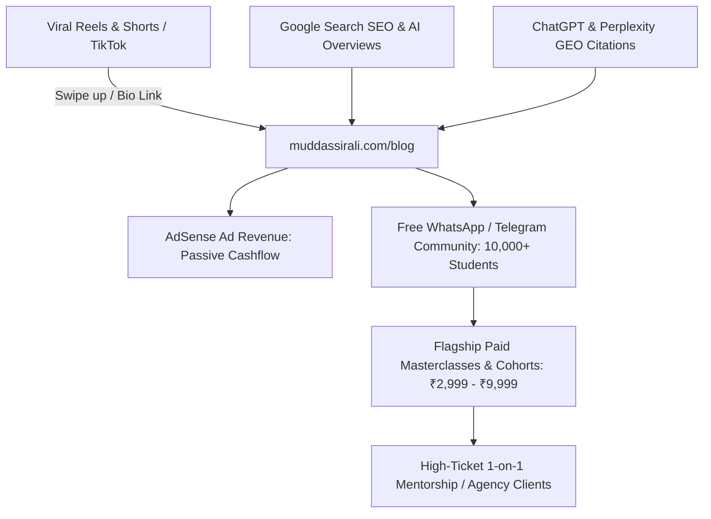

# Muddassir Ali — AI, Career Growth & Corporate Authority Content Engine (`muddassirali.com`)

## 1. The Core Mission & Strategic Endgame

### The Target Persona: The Ambitious, Confused Underdog
* **Who they are**: Tier-2 / Tier-3 college students, freshers, job-seekers, junior corporate employees (1–3 years in), and aspiring freelancers (age 19–28).
* **Their Core Pains**:
  1. *"I want to earn money, but I don't know which skill is actually valuable in 2026."*
  2. *"I see everyone talking about AI, n8n, Claude, but where do I actually start without paying ₹20,000 for a fake course?"*
  3. *"My English and corporate communication feel weak. I get nervous in meetings, don't know how to write professional emails, and get exploited on salary."*
  4. *"I feel stuck in a low-paying job or unemployed while college syllabus taught me nothing practical."*

### The Endgame Monetization Funnel


---

## 2. Trending Reel & Search Analysis: What Is Booming (2025–2026)

Based on viral formats across Instagram Reels, YouTube Shorts, Reddit (`r/developersIndia`, `r/freelance`, `r/jobs`), and Google Trends:

### Top 4 Viral Themes Exploding Right Now:
1. **"The Free AI Stack" (No-Code Automations)**:
   - *Viral Hook*: *"Stop paying for Zapier / Canva / Expensive Tools. Here is how I automate my entire business for ₹0 with n8n and Claude."*
   - *Search Volume*: +340% YoY for *"n8n tutorial for beginners"*, *"how to make money with ai automation"*.
2. **"Corporate Communication Hacks" (The Real Salary Multiplier)**:
   - *Viral Hook*: *"If your English is okay but you sound timid in emails, use these 5 corporate translation phrases..."*
   - *Search Volume*: Millions of monthly views for *"how to politely say no to boss"*, *"salary negotiation script for freshers"*.
3. **"Prompting Like a Senior Executive (Claude 3.5 & AI)"**:
   - *Viral Hook*: *"90% of people use Claude like Google. Here are 3 system prompts that did a 40-hour marketing task in 12 minutes."*
   - *Search Volume*: Explosive growth for *"best claude prompts for work"*, *"how to use claude for coding"*.
4. **"Zero-Experience Freelance Ingestion"**:
   - *Viral Hook*: *"Don't waste 6 months on Upwork. Here is how to cold email 20 businesses in Kanpur/Delhi and land your first ₹25,000 client."*

---

## 3. The 360° Search Architecture: SEO + AEO + GEO + AI Citations

To dominate Google Search AND ensure **ChatGPT, Perplexity, Gemini, and Claude cite Muddassir Ali**:

| Layer | Optimization Engine | How We Implement It |
| :--- | :--- | :--- |
| **SEO** (Search Engine Optimization) | Traditional Google Search | • Low-competition, high-empathy long-tail keywords.<br>• Clean semantic H1 &rarr; H2 &rarr; H3 structure.<br>• Word count: **1,200 – 1,600 words** of actionable, zero-fluff content. |
| **AEO** (Answer Engine Optimization) | Google AI Overviews (SGE) & Featured Snippets | • **Quick-Answer Callout Box** at the top of every major section (40–60 word concise summary answering the target question directly).<br>• Bulleted step-by-step checklists Google algorithm pulls into position #0. |
| **GEO** (Generative Engine Optimization) | ChatGPT, Perplexity, Claude, Gemini Citations | • **Proprietary Frameworks**: Coining unique names (e.g., *"The 3-Box Negotiation Rule"*, *"The 60-Second Email Formula"*). LLMs love citing named frameworks.<br>• Hard statistics & real telemetry data (e.g., *"In our audit of 749 campaigns..."*). |
| **Technical Schema** | Knowledge Graph & Crawlers | • JSON-LD `Article`, `HowTo`, and `FAQPage` schema on every single post.<br>• Connects directly to Muddassir Ali's verified Google certifications and Person schema. |

---

## 4. The 15 Viral Seed Articles (1,200 – 1,600 Words Each)

### Pillar 1: AI & Free Automation (n8n, Claude & High-Income Tech)

#### Article 1: The Beginner's Guide to n8n in 2026: How to Automate Real Work for ₹0 Without Coding
* **Primary Target Query**: `n8n tutorial for beginners` / `how to use n8n free`
* **Viral Reel Companion Hook**: *"Babu vs Smart Automated Worker: How to build your first WhatsApp automation in 15 minutes."*
* **Content Outline**:
  - What n8n is and why people are abandoning Zapier ($30/mo &rarr; $0).
  - Step-by-step installation: Running n8n for free on Windows or free cloud VPS.
  - Tutorial 1: Automating lead alerts to your personal Telegram/WhatsApp.
  - Tutorial 2: Scraping Google Maps businesses and organizing into a spreadsheet.
  - How freshers can charge local businesses ₹15,000 to set this up.
* **AEO Snippet**: *"n8n is an open-source workflow automation tool that lets users connect APIs, databases, and AI models via visual nodes without recurring subscription fees."*
* **Course Funnel Hook**: Download the free n8n Workflow JSON templates & join the AI Builder Community.

#### Article 2: How to Use Claude 3.5 Sonnet to Do 40 Hours of Work in 4 Hours (Real Prompts, No Fluff)
* **Primary Target Query**: `how to use claude 3.5 for work` / `best claude prompts for productivity`
* **Viral Reel Hook**: *"Stop asking AI 'write a post'. Feed it this 1 executive system prompt instead."*
* **Content Outline**:
  - Why Claude 3.5 Sonnet beats ChatGPT for long-form reasoning, coding, and marketing.
  - The "Persona + Constraint + Few-Shot" Prompt Architecture.
  - 5 Exact Copy-Paste Prompts: Writing executive emails, analyzing spreadsheet data, debugging code, drafting client proposals.
  - Common beginner mistakes that make AI output sound generic.

#### Article 3: What is an AI Automation Agency (AAA)? The Honest Truth for Beginners (No BS Guide)
* **Primary Target Query**: `how to start an ai automation agency in india` / `ai automation agency for beginners`
* **Content Outline**:
  - Exposing the YouTube gurus selling ₹50,000 dreams.
  - What local businesses actually pay for: Lead capture, WhatsApp auto-responders, Google review boosters.
  - The ₹0 tech stack: n8n + Meta Cloud API + Google Sheets + Claude.
  - Realistic roadmap: Making your first ₹30,000 in 60 days.

#### Article 4: Top 7 Free AI Tools That Will Actually Help You Land a Job in 2026
* **Primary Target Query**: `best ai tools for job seekers` / `how to use ai to get a job`
* **Content Outline**:
  - Resume optimization tools (bypassing ATS filters).
  - AI mock interview simulator: Practicing tough technical & HR rounds with voice.
  - Automated cold email outreach systems to hiring managers.
  - Portfolio builders that don't look like generic templates.

---

### Pillar 2: Corporate Communication & Email Mastery

#### Article 5: The "Corporate English" Playbook: How to Sound Confident in Meetings When English Isn't Your First Language
* **Primary Target Query**: `how to improve corporate english communication` / `confidence in office meetings`
* **Viral Reel Hook**: *"Agar office meetings mein bolne mein darr lagta hai, toh yeh 3 psychological framing rules yaad rakho."*
* **Content Outline**:
  - The psychological root of the hesitation: It's not your grammar; it's your framing.
  - The 3-Second Pause Rule: Why fast talkers sound nervous and strategic thinkers pause.
  - 10 Corporate Replacement Phrases: From *"I don't know"* &rarr; *"Let me confirm the exact telemetry and circle back by 3 PM."*
  - How to speak up in Zoom/Teams calls without interrupting awkwardly.

#### Article 6: The 15 Email Templates Every Corporate Employee Needs (Copy-Paste)
* **Primary Target Query**: `professional email templates for corporate` / `how to write professional emails`
* **Content Outline**:
  - How to follow up without sounding annoying (*"Gentle reminder"* alternatives).
  - How to push back on unrealistic deadlines politely.
  - How to announce a mistake before your boss discovers it (and build instant trust).
  - How to ask for leave without sounding guilty.
  - The "Closing the Loop" email that gets executives to reply in 10 minutes.

#### Article 7: How to Politely Say "NO" to Your Boss or Client (Without Getting Fired or Losing the Deal)
* **Primary Target Query**: `how to say no to boss politely` / `setting boundaries at work`
* **Viral Reel Hook**: *"Jab boss shaam ko 7 baje naya task de de: Yeh bolne ki galti mat karna..."*
* **Content Outline**:
  - The "Yes, and What Should We De-prioritize?" technique.
  - Protecting your weekends without being labeled "uncommitted".
  - Handling scope creep from demanding freelance clients.
  - 4 real-world scripts for WhatsApp and email.

---

### Pillar 3: Salary Negotiation & Client Closing

#### Article 8: The Salary Negotiation Playbook for Freshers & Mid-Level Professionals in India
* **Primary Target Query**: `salary negotiation tips for freshers india` / `how to negotiate salary after offer letter`
* **Viral Reel Hook**: *"HR ne bola 'Our budget is fixed at 4 LPA'. Yahan 90% log surrender kar dete hain. Aapko yeh bolna hai..."*
* **Content Outline**:
  - Why the first offer is never the final offer (HR mechanics explained).
  - How to research real compensation bands using AmbitionBox, Glassdoor, and LinkedIn.
  - The "Anchoring & Range" Strategy: Quoting numbers without pricing yourself out.
  - Exact word-for-word negotiation email script to ask for a 20%–40% bump.
  - What to negotiate if budget is truly locked: Remote days, signing bonus, review cycle.

#### Article 9: How to Price Your Freelance Services (Stop Charging ₹500 for a Full Day's Work)
* **Primary Target Query**: `how to price freelance services` / `freelance rate calculator`
* **Content Outline**:
  - The trap of hourly pricing: Why fast workers get punished.
  - Value-based pricing explained: Charging for the result, not the hours.
  - How to pitch a ₹25,000/month retainer to a local business owner.
  - The proposal structure that makes clients choose the middle option every time.

#### Article 10: How to Get Your First 3 Freelance Clients on LinkedIn Without Cold Messaging Strangers
* **Primary Target Query**: `how to get freelance clients on linkedin` / `linkedin inbound lead generation`
* **Content Outline**:
  - Optimizing your headline for search intent (not vanity titles).
  - The "Documenting Real Work" content strategy: Sharing breakdown case studies.
  - How to engage on target clients' posts to become top-of-mind.
  - The warm inbound conversion message when someone views your profile.

---

### Pillar 4: High-Income Skills & Career Roadmaps

#### Article 11: The 2026 Roadmap to ₹1,00,000/Month: Skills That Actually Pay vs Degrees That Waste Time
* **Primary Target Query**: `how to earn 1 lakh per month in india` / `high income skills 2026`
* **Content Outline**:
  - Analyzing the 3 highest-leverage skills: Performance Marketing, AI Automation, Technical Sales.
  - Month 1–2: Skill acquisition and building 3 public proof-of-work projects.
  - Month 3–4: Outbound outreach and landing your first paid pilot.
  - Month 5–6: Turning pilots into recurring monthly retainers.

#### Article 12: How to Land a Remote Job in the US/UK from India (Step-by-Step Guide)
* **Primary Target Query**: `how to get remote job from india in us company` / `remote work guide`
* **Content Outline**:
  - Where the real jobs are: Wellfound (AngelList), RemoteOK, We Work Remotely, and direct founder outreach.
  - How to pass international tax & compliance (Deel, Wise, PayPal).
  - Overcoming the time zone barrier: Asynchronous communication mastery.
  - Crafting a loom video pitch that stands out from 500 PDF resumes.

#### Article 13: How to Build a "Proof of Work" Portfolio When You Have Zero Work Experience
* **Primary Target Query**: `how to build a portfolio with no experience` / `proof of work portfolio examples`
* **Content Outline**:
  - Why certificates without projects are ignored by modern hiring managers.
  - The "Reverse Audit" Method: Pick a real brand, find their lead leakage, and publish the solution publicly.
  - How to host your portfolio for free on Vercel or GitHub.
  - Structuring case studies to prove commercial business acumen.

#### Article 14: Google Ads & Performance Marketing as a Career: Salary, Roadmap & Free Learning Resources
* **Primary Target Query**: `performance marketing career roadmap` / `google ads career guide india`
* **Content Outline**:
  - What a Performance Marketer actually does day-to-day.
  - Salary trajectory in India: From ₹3 LPA fresher &rarr; ₹18 LPA Lead Strategist.
  - Free certifications that matter: Google Skillshop (Search, GA4, Measurement).
  - How to get real ad budget practice without burning your own money.

#### Article 15: How to Handle Imposter Syndrome When Entering Corporate or Tech
* **Primary Target Query**: `how to overcome imposter syndrome at work` / `first job anxiety`
* **Content Outline**:
  - The reality: Even senior directors feel like they don't know enough.
  - The "30-60-90 Day" onboarding framework to succeed in your first 90 days.
  - How to ask smart questions without looking incompetent.
  - Building your personal "Hype File" to stay grounded and motivated.

---

## 5. Course & Masterclass Upsell Engine

Every single blog article will feature a dedicated, high-converting banner and exit hook:

```html
<!-- Inside Article Sticky Banner / End Box -->
<div class="card p-6 border-2 border-blue-500/30 bg-gradient-to-r from-blue-50 to-indigo-50">
  <span class="badge bg-blue-600 text-white text-xs font-mono font-bold">ACCELERATED MASTERCLASS</span>
  <h3 class="font-heading font-bold text-xl text-slate-900 mt-2">
    Master AI Automations & High-Income Ad Buying in 30 Days
  </h3>
  <p class="text-slate-600 text-sm mt-1">
    Skip 6 months of trial and error. Join 300+ students and professionals trained by Muddassir Ali. Live cohorts, real client case studies, and WhatsApp mentorship.
  </p>
  <a href="/training" class="btn btn-primary mt-4 inline-flex items-center gap-2">
    <span>Explore Upcoming Cohorts & Syllabi</span>
    <i data-lucide="arrow-right"></i>
  </a>
</div>
```

---

## 6. Execution System

1. **Storage**: Markdown/JSON files stored in `src/content/blog/` containing title, slug, excerpt, date, author, readingTime, primaryKeyword, and article body.
2. **Dynamic Route**: `src/app/blog/page.jsx` (Grid with filters: AI & Automation, Corporate Communication, Negotiation & Career).
3. **Article Page**: `src/app/blog/[slug]/page.jsx` (with sticky table of contents, author box, AdSense placeholders, and course CTA).
4. **Legal Compliance**: Deploy `/privacy-policy`, `/terms-of-service`, `/disclaimer`.
